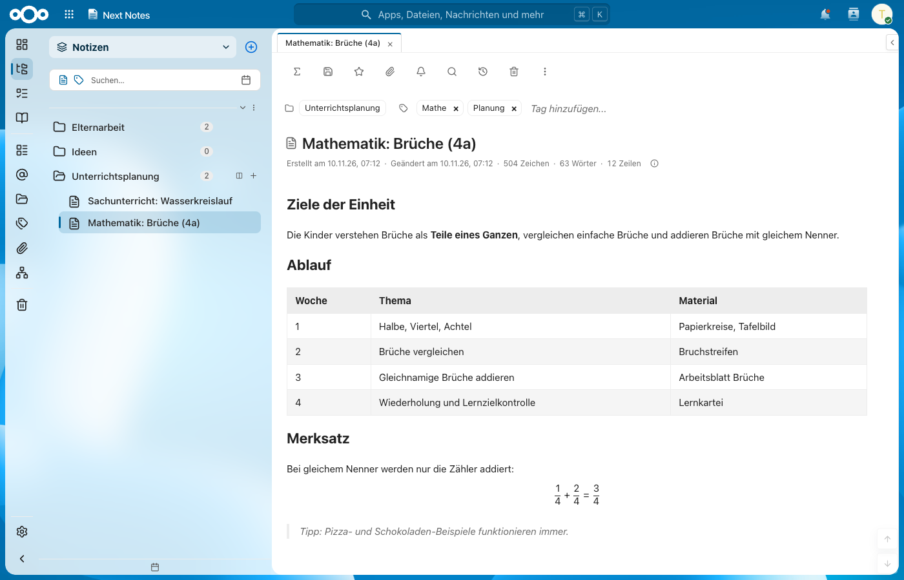
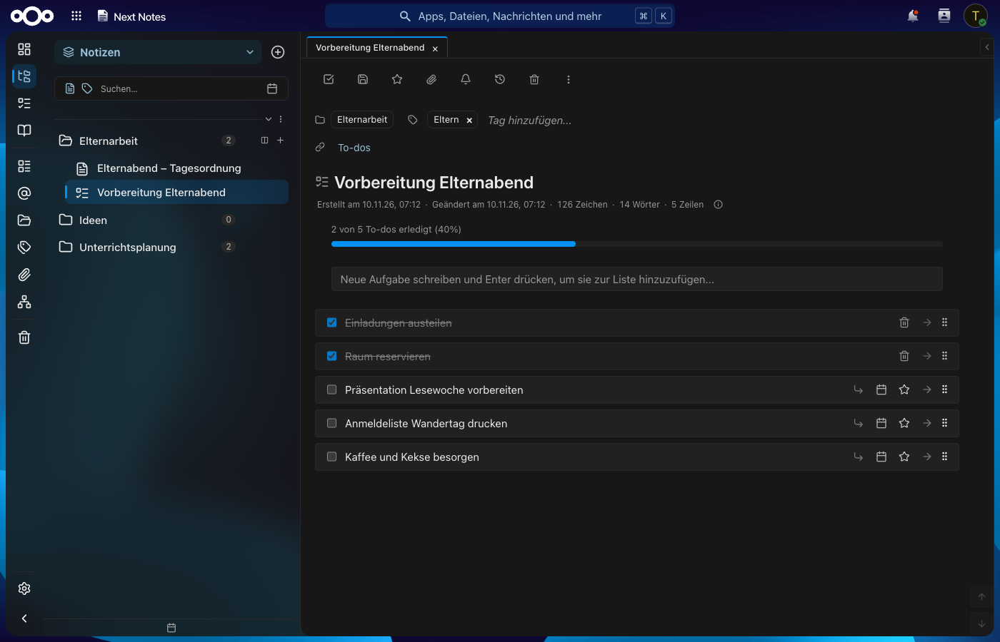
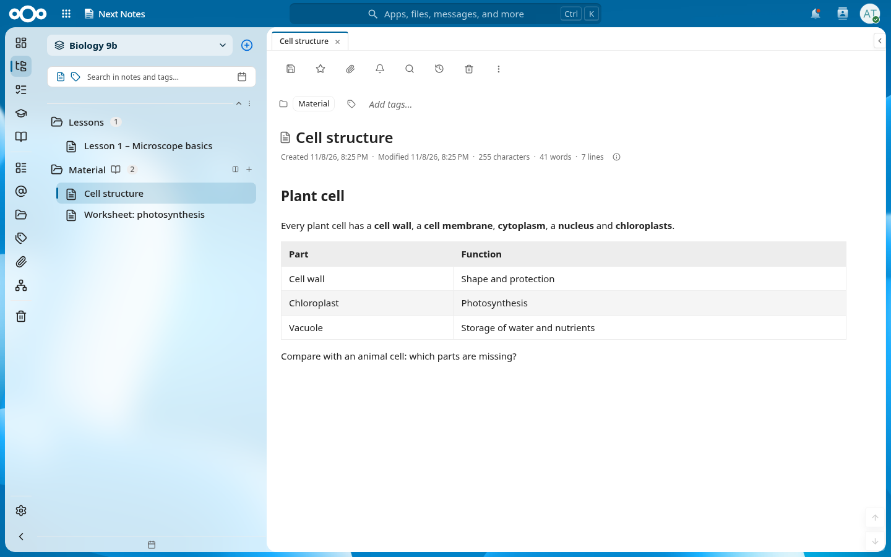
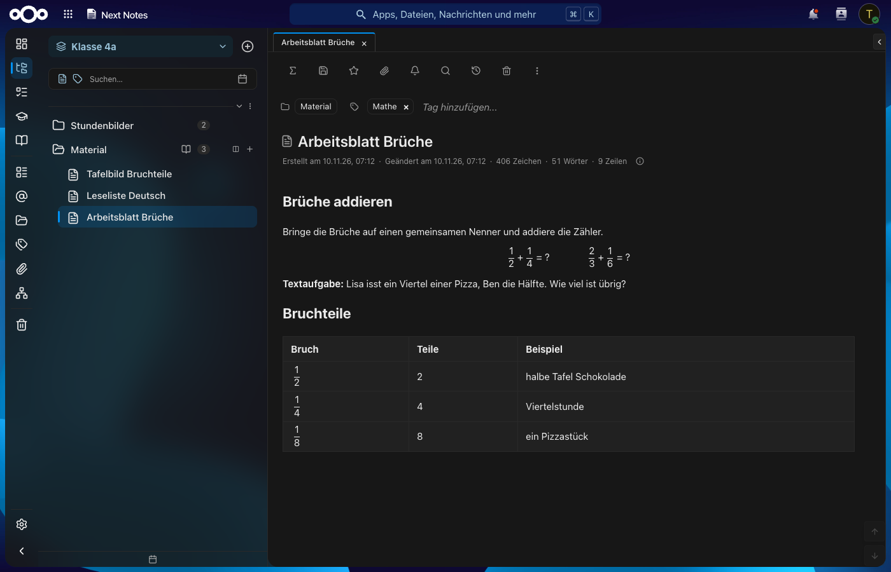
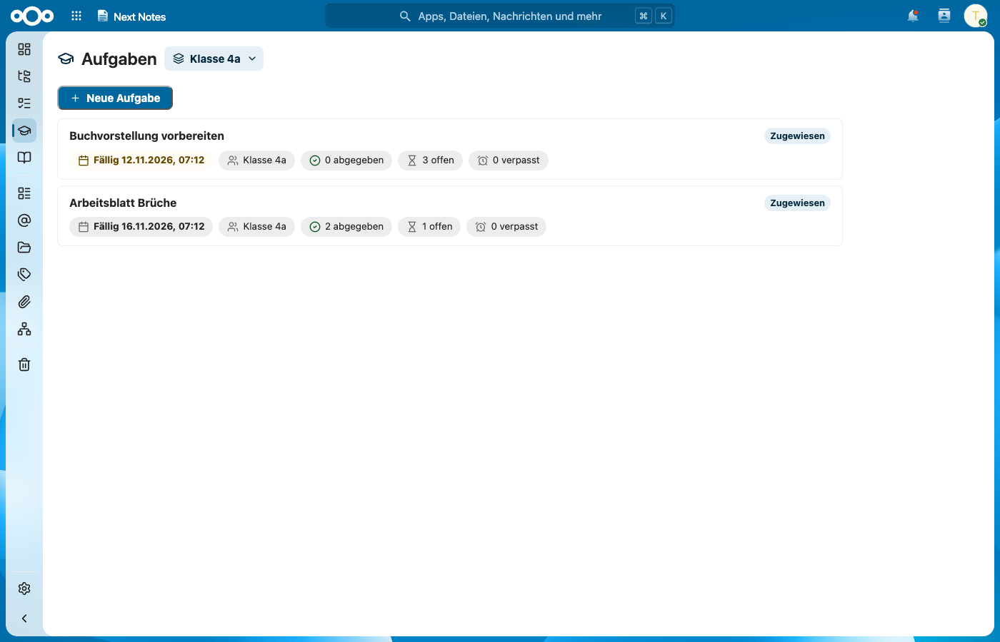
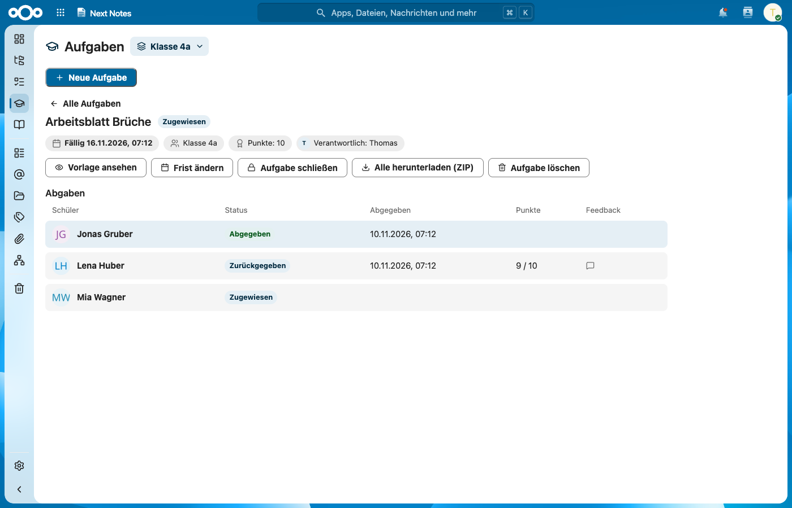
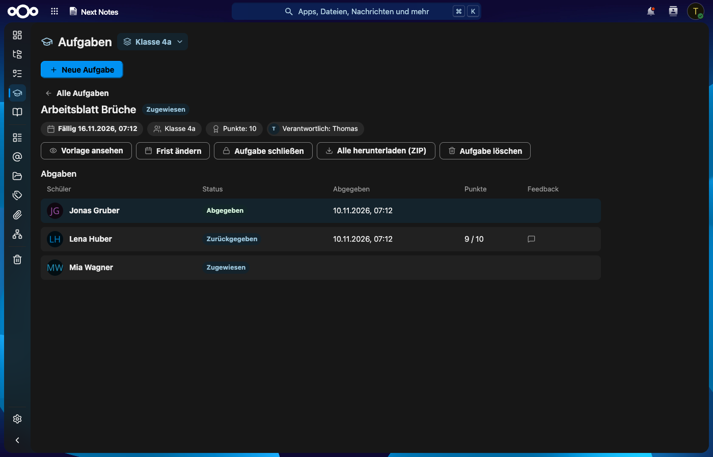
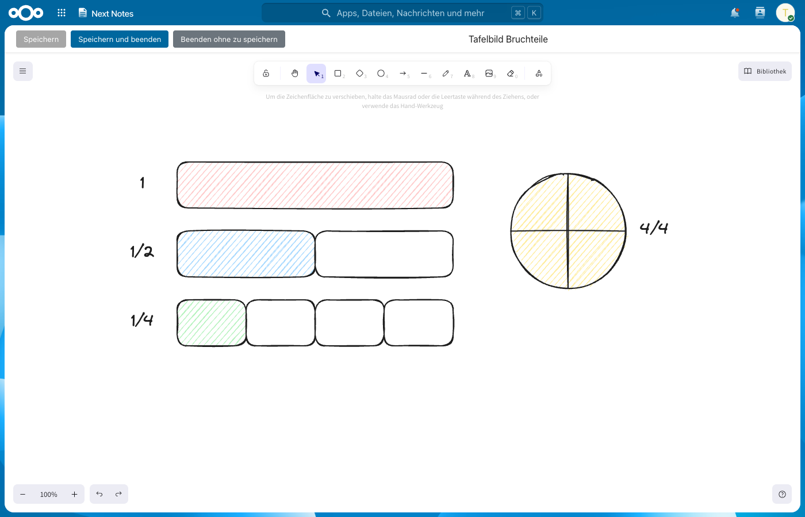
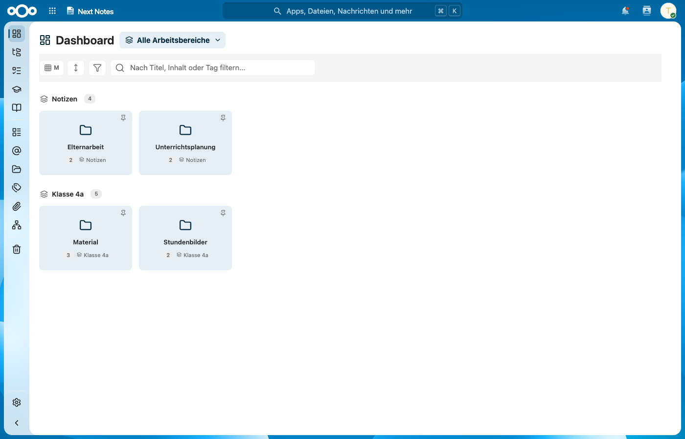

<!--
  - SPDX-FileCopyrightText: 2026 Thomas Weissel
  - SPDX-License-Identifier: AGPL-3.0-or-later
-->
# Next Notes

**Notes, team workspaces and assignments for Nextcloud.**

Next Notes is a native Nextcloud app for notes, folders and tags in private, shared and team workspaces. Teachers publish material for a class and hand out assignments that students work on, submit and get back with feedback – all inside your own Nextcloud.

[](https://nextcloud.com)
[](https://www.php.net)
[](nextnotes/COPYING)


Website: <https://valueerrorx.github.io/nextnotes/>



## Features

### Notes and editor
- Rich text and Markdown notes, task lists and Excalidraw drawings.
- Math formulas (KaTeX), Mermaid diagrams and code highlighting.
- Spreadsheet-like tables with formulas and a calculator block with unit conversion and function graphs.
- Folders, tags, attachments, revisions, trash, backlinks and a graph of linked notes.
- To-dos across all task lists, a diary with calendar, a dashboard and full-text search.

### Workspaces and teams
- **Private** workspaces for yourself.
- **Shared** workspaces: share with single users, read only or with edit rights.
- **Team** workspaces owned by a Nextcloud team: access follows team membership.
- **Material folders:** teachers (moderator or higher in the team) edit, members read and can copy a note into their own workspace.

### Assignments for schools
- Hand out a note with a deadline and optional points; every student gets a private copy.
- Students submit before the deadline; the copy becomes read only.
- Teachers review, give feedback and points and return the submission – or reopen it for revision.
- Students who join later get their copy automatically; teachers get one summary when the deadline has passed.
- Export all submissions of an assignment as ZIP. Submissions are kept for the teachers when a student leaves the team or the account is deleted.

### OneNote import
- Users import their own Microsoft OneNote notebooks, including images and files, into their own workspaces through Microsoft Graph.
- Needs an app registration in the school's Microsoft Entra tenant, set up by the administrator ([setup, German](docs/app/admin.md#13-onenote-import)).

### Nextcloud integration
- Nextcloud login, users, groups and teams (Circles) – no separate accounts.
- Reminders and @-mentions as Nextcloud notifications; notes show up in the Nextcloud unified search.
- Light and dark mode and the font follow the Nextcloud theme.
- `occ` commands for data export, deletion, team checks and uninstalling.

### Privacy
- All data stays in your Nextcloud database and data directory; the app sends nothing to third parties and has no AI features.
- Every request is checked on the server against the user and team permissions.
- Export of all own notes as files or ZIP (readable by Poznote), user data export for admins (`occ nextnotes:export-user` and the User migration app).

## Screenshots

| | |
|---|---|
|  |  |
| Note with table and formula | Task list, dark mode |
|  |  |
| Team workspace with material folder | Worksheet in the material folder, dark |
|  |  |
| Assignments of a class | Submissions with status and points |
|  |  |
| Assignment, dark | Excalidraw drawing |
|  | |
| Dashboard | |

The screenshots show the German interface with made-up sample data.

## Requirements
- Nextcloud 35 (other versions are refused), PHP 8.3–8.5.
- MariaDB/MySQL, PostgreSQL or SQLite.
- Background jobs via system cron (recommended; required for the OneNote import).
- Optional: the **Teams** app (`circles`) for team workspaces, material folders and assignments; the **Contacts** app to create and manage teams.

## Installation
- **App Store:** once published, *Apps → Office & text → Next Notes → Download and enable*.
- **Release package:** extract `nextnotes-<version>.tar.gz` into a writable apps directory (for example `custom_apps/`), then run `occ app:enable nextnotes`.
- **Build the package yourself:** Node 20+, GNU tar and GNU gzip, then
  ```sh
  npm ci --prefix nextnotes/build
  make -C nextnotes dist      # -> nextnotes/dist/nextnotes-<version>.tar.gz
  ```

Next Notes is **beta** (version 0.9.3). Make a backup before updating and read the update notes.

## Documentation (German)
- [Administration](docs/app/admin.md): installation, groups, web server, cron, settings, `occ` commands, data protection, removal, OneNote import setup.
- [Update](docs/app/upgrade.md): updating, backups, no downgrade.
- [User guide](docs/app/user.md): workspaces, teams, material, assignments, to-dos, diary, formulas, OneNote import.
- [Changelog](nextnotes/CHANGELOG.md)

## Development
- The app lives in [`nextnotes/`](nextnotes/); the editor and interface come from the Poznote frontend in [`src/`](src/), changed only where needed.
- Build the frontend bundles: `npm ci --prefix nextnotes/build` once, then `make -C nextnotes build`; `make -C nextnotes check-upstream` checks the bundles against the Poznote sources.
- Test environments with Docker (SQLite, MariaDB, PostgreSQL, nginx), PHPUnit and Playwright tests: see [`dev/nextcloud/README.md`](dev/nextcloud/README.md) (German). Docker is only used for tests, never in production.
- Bugs and ideas: [issues](https://github.com/valueerrorx/nextnotes/issues).

## Credits and license
Next Notes is **based on [Poznote](https://github.com/timothepoznanski/poznote) by Timothé Poznanski**. The editor, the notes interface and many ideas come from Poznote; Next Notes replaces its backend with a Nextcloud app and adds teams, material and assignments. Thank you, Timothé!

- Next Notes code: [AGPL-3.0-or-later](nextnotes/COPYING), © 2026 Thomas Weissel.
- Parts taken from Poznote: [MIT](LICENCE), © 2025 Timothé Poznanski.
- Bundled third-party libraries: [THIRD-PARTY-NOTICES.md](nextnotes/THIRD-PARTY-NOTICES.md).
